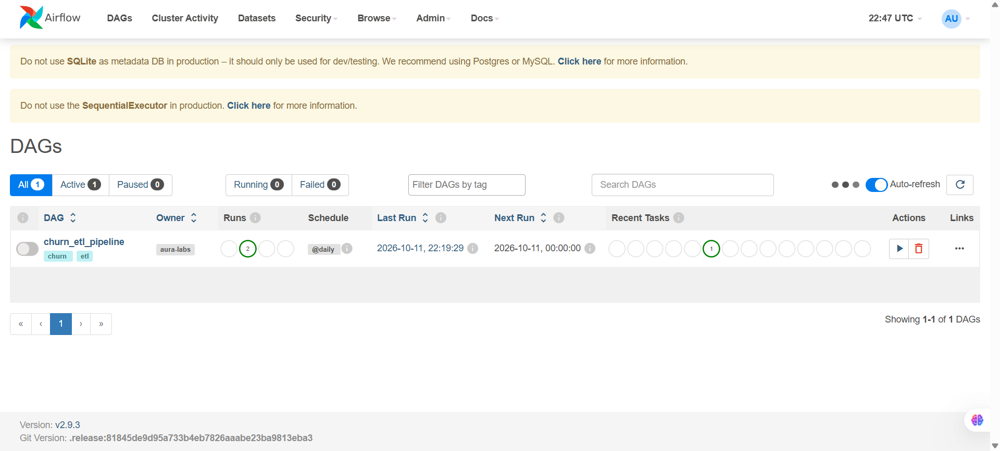
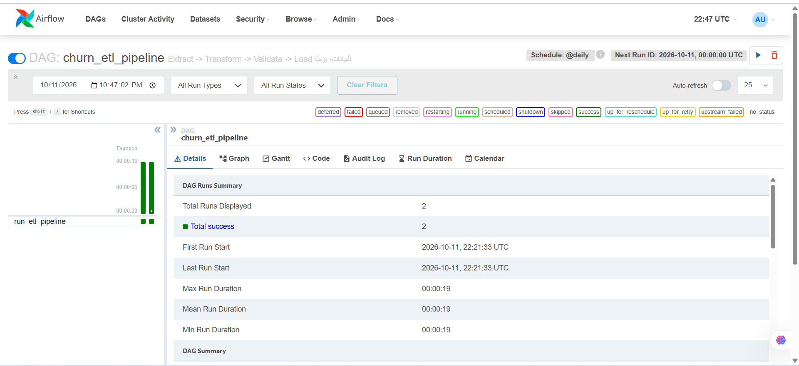

# Churn Prediction ETL & ML Pipeline

An end-to-end data engineering and machine learning project that predicts which bank customers are likely to leave (churn). It covers the whole path: raw CSV → cleaning and validation → Parquet + BigQuery → SQL exploration → feature engineering → model training and tuning → a prediction API → Docker → scheduled orchestration with Airflow.

Built by **AURA Labs**.

---

## What it does

| Stage | What happens | Where |
|---|---|---|
| Extract | Reads the raw CSV (path comes from `config/config.yaml`) | `src/data/extract.py` |
| Transform | Snake-case columns, type downcasting, range and category fixes | `src/data/transform.py` |
| Validate | Hard quality gate: schema, nulls, duplicates, allowed categories, churn-rate sanity. If it fails, the pipeline stops before loading | `src/data/validate.py` |
| Load | Writes Parquet locally and (optionally) loads to BigQuery | `src/data/load.py` |
| Explore | SQL analysis with DuckDB (local) and BigQuery (cloud) | `src/data/explore_sql.py`, `explore_bigquery.py` |
| Features | One-hot encoding + engineered features, saves the exact column list used for training | `src/features/build_features.py` |
| Models | Random Forest, XGBoost, Logistic Regression, threshold analysis, hyper-parameter search | `src/models/` |
| API | FastAPI service that returns a churn probability and a decision | `src/api/` |
| Orchestration | Airflow DAG that runs the ETL daily | `dags/churn_pipeline_dag.py` |

---

## Key decisions (and why)

- **Data validation is a gate, not a report.** A custom `DataValidationError` halts the pipeline so bad data never reaches Parquet or BigQuery.
- **The `complain` column is excluded from the final models.** It is almost a copy of the target (customers who complained had already decided to leave), so using it would inflate the metrics without helping to predict churn early. The model is built on real behavioural and profile signals instead.
- **Class imbalance (about 20% churn) is handled in the model**, not by resampling: `class_weight="balanced"` for Random Forest and Logistic Regression, and `scale_pos_weight` computed from the data (about 3.9) for XGBoost.
- **Accuracy is not the main metric.** With 80/20 classes, accuracy is misleading. I use ROC-AUC (threshold-independent), plus recall, precision and the confusion matrix at a chosen threshold.
- **The decision threshold is tuned, not left at 0.50.** Missing a customer who is about to leave costs more than a false alarm. I compared thresholds by marginal analysis (how much precision is lost per unit of recall gained) and the API uses **0.40**.
- **No training-serving skew.** The exact feature columns used in training are saved to `feature_columns.json`, and the API re-indexes every request to that list.
- **Absolute imports (`from src.data.x import y`).** This lets the same code run as a script, from Docker, and from Airflow.

---

## Results

> Fill these in from your own run of `python -m src.models.evaluate`.

| Model | ROC-AUC | Recall (churners) | Precision (churners) |
|---|---|---|---|
| Logistic Regression | _xx_ | _xx_ | _xx_ |
| Random Forest | _xx_ | _xx_ | _xx_ |
| **XGBoost (threshold 0.40)** | _xx_ | _xx_ | _xx_ |

---

## Project structure

```
.
├── config/
│   └── config.yaml              # paths, BigQuery project/dataset/table
├── dags/
│   └── churn_pipeline_dag.py    # Airflow DAG: churn_etl_pipeline
├── data/
│   ├── raw/                     # put the Kaggle CSV here (not in git)
│   └── processed/               # generated Parquet files (not in git)
├── joblib/                      # trained models + feature_columns.json (not in git)
├── src/
│   ├── data/                    # extract, transform, validate, load, pipeline, explore_*
│   ├── features/                # build_features
│   ├── models/                  # train, evaluate, tune
│   └── api/                     # FastAPI app (main.py, schemas.py)
├── Dockerfile                   # API image
├── Dockerfile.airflow           # Airflow image
├── docker-compose.yml
└── requirements.txt
```

Every folder under `src/` needs an `__init__.py` so that `python -m src....` works.

---

## Getting started

### 1. Get the data

Download the dataset from Kaggle and place the CSV in `data/raw/`:

https://www.kaggle.com/datasets/radheshyamkollipara/bank-customer-churn

The file name must match `raw_filename` in `config/config.yaml`.

### 2. Set up the environment

Python 3.11 is recommended.

```bash
python -m venv .venv

# Windows
.venv\Scripts\activate
# macOS / Linux
source .venv/bin/activate

pip install -r requirements.txt
```

### 3. Run the ETL pipeline

Run everything from the project root with `-m`:

```bash
python -m src.data.pipeline
```

This extracts, cleans, validates and writes `data/processed/customer_churn_clean.parquet`.

### 4. (Optional) Load to BigQuery

1. Install the Google Cloud CLI and authenticate once:
   ```bash
   gcloud auth application-default login
   ```
2. Set `bigquery.project_id` (and dataset/table) in `config/config.yaml`.
3. Call `run_pipeline(upload_to_bigquery=True)` or run `python -m src.data.load`.

If `project_id` is empty, the BigQuery step is skipped.

### 5. Explore with SQL

```bash
python -m src.data.explore_sql        # DuckDB on the Parquet file
python -m src.data.explore_bigquery   # BigQuery (requires step 4)
```

### 6. Build features and train

```bash
python -m src.features.build_features
python -m src.models.train
python -m src.models.evaluate
python -m src.models.tune             # optional: Random Forest hyper-parameter search
```

Models and `feature_columns.json` are saved to `joblib/`. They are not committed, so run training once after cloning.

### 7. Run the API

```bash
uvicorn src.api.main:app --reload
```

- Health check: http://127.0.0.1:8000/health
- Interactive docs (try `/predict` here): http://127.0.0.1:8000/docs

---

## Docker

```bash
# Prediction API (needs trained models in ./joblib)
docker compose up -d --build api

# Run the ETL once inside a container
docker compose --profile etl run --rm etl

# Airflow
docker compose up -d --build airflow
```

Note: BigQuery credentials are not available inside the containers, so `upload_to_bigquery` stays `False` there.

---

## Airflow

The DAG `churn_etl_pipeline` runs `run_pipeline()` daily (`catchup=False`).

1. Start it: `docker compose up -d airflow` (the first start takes a few minutes).
2. Get the admin password:
   ```bash
   docker logs churn_airflow 2>&1 | grep -i password
   ```
   On Windows PowerShell: `docker logs churn_airflow 2>&1 | Select-String "password"`.
3. Open http://localhost:8080 and sign in as `admin`.
4. Un-pause the DAG and trigger it, from the UI or:
   ```bash
   docker exec churn_airflow airflow dags unpause churn_etl_pipeline
   docker exec churn_airflow airflow dags trigger churn_etl_pipeline
   docker exec churn_airflow airflow dags list-runs -d churn_etl_pipeline
   ```

Airflow runs in `standalone` mode (SQLite, one container). That is fine for development and demos, but not for production.

### Screenshots

The DAG list and a successful run history (both runs finished in about 19 seconds):





---

## Tech stack

Python · pandas · PyArrow / Parquet · DuckDB · Google BigQuery · scikit-learn · XGBoost · FastAPI · Pydantic · Uvicorn · Docker / Docker Compose · Apache Airflow

---

## Possible next steps

- Hyper-parameter tuning for XGBoost (for example with Optuna)
- Unit tests for the transform and validate steps
- Write pipeline logs and validation reports to files
- Pass BigQuery credentials to containers through secrets
- CI with GitHub Actions

---

## Data source

Bank Customer Churn dataset on Kaggle: https://www.kaggle.com/datasets/radheshyamkollipara/bank-customer-churn